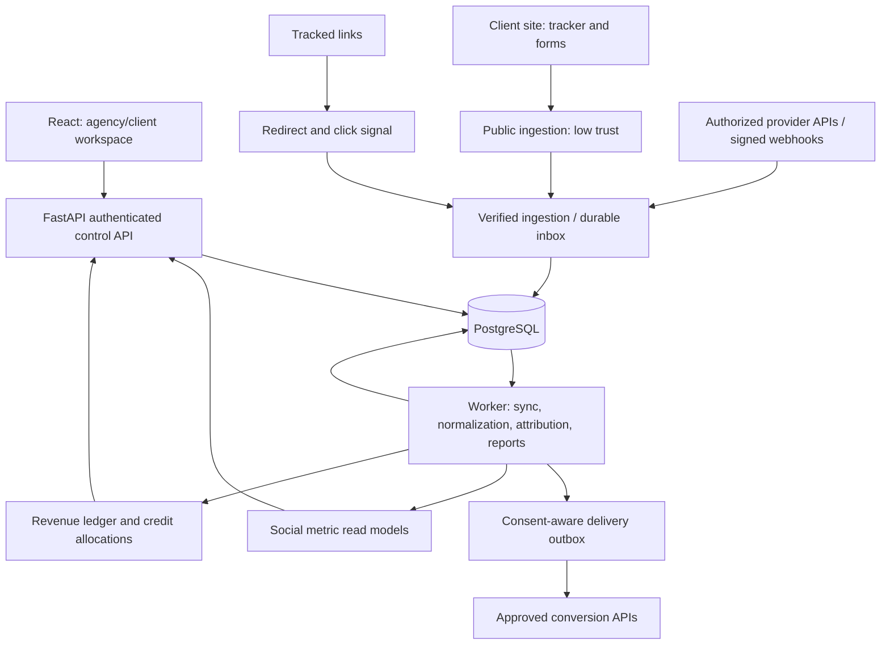

# Proposed system architecture
Status: Draft. FastAPI, PostgreSQL, React, Docker, and the commercial product scope are confirmed. Other architecture choices remain proposals for review.

Implementation update: D-014 approves SQLAlchemy/Psycopg/Alembic, and D-017 approves the implemented [002-A schema and service access model](../../specs/002-tenancy-access/design.md). D-019 also approves the implemented [auth/access design](../../specs/002-tenancy-access/auth-design.md). The remaining system-wide design below is proposed; queues, connectors, production delivery, and RLS are not implied to be implemented.

## Components and trust boundaries


A modular monolith is proposed initially, with workers running as separate processes using shared contracts. Durable work must not rely on non-durable in-process tasks. No broker or queue has been selected; PostgreSQL-backed, Redis-based, and managed options require evaluation against load and delivery guarantees. Verification does not remove the original trust classification from a browser event.

## Data boundaries
- Control: agencies, clients, members, credentials, permissions, and SaaS billing.
- Collection: links, visits, touchpoints, and forms; browser data is not financial proof.
- Social: account/content metrics with platform definitions, time windows, and source versions.
- Identity: deterministic identifiers linked only within a client, with provenance and consent.
- Financial: payments, refunds, chargebacks, manual adjustments, and currency evidence.
- Attribution: derived allocations with model, version, and window; results can be rebuilt.
- SaaS subscription billing remains separate from client-business revenue.

## Conceptual model for review
```text
Agency -> ClientWorkspace -> Site / SocialConnection / Campaign / Content / Link
AgencyMembership / ClientGrant -> authorized resource access
ClientWorkspace -> Subject -> IdentityKey / Touchpoint
ClientWorkspace -> RevenueTransaction -> LedgerEntry / Refund
AttributionRun -> CreditAllocation -> ledger / touchpoint / model references
Connection -> SyncRun / Checkpoint / MetricFact / Capability
Cross-cutting: OutboxDelivery, AuditEvent, ConsentRecord, DeletionRequest, UsageMeter
```

This is not a final schema. Tenant/client-scoped composite keys and foreign keys can prevent references across authorization boundaries. PostgreSQL row-level security is a possible additional defense after validating database roles. It must not replace application authorization; the application role must not bypass applicable policies.

## Proposed calculation rules
- Preserve separate occurred_at, received_at, and processed_at timestamps and the source timezone.
- Do not arbitrarily sum social metrics. Cross-platform reach is not a count of unique people.
- Represent money exactly and retain original currency; define conversions explicitly.
- Total attribution credit equals eligible net revenue after defined rounding.
- Preserve financial adjustments and provenance; do not erase a refund to correct a dashboard.
- Version source, metric, and model definitions; reprocessing preserves audit history.
- Privacy deletion may require removal of identifiers or payloads. Financial retention and anonymization rules depend on approved markets and policies; the term immutable must not silently override deletion requirements.

## Security and operations
Use OAuth state and PKCE as appropriate to the provider flow, encrypt tokens with keys managed separately from stored ciphertext, verify webhook signatures before processing, keep secrets server-side, and define rate/body limits, replay windows, SSRF protections, and redacted auditing.

Every job carries agency/client context and an idempotency boundary. Define backoff with jitter, dead-letter handling, and restricted replay tools. Warehouses, microservices, Kubernetes, and hosting providers are not automatic choices. Production design belongs to specification 020 after sizing and hosting decisions.

## Dependency isolation
Under D-011, Python dependencies belong in a project virtual environment and are declared in backend/requirements.txt. Frontend dependencies remain local and use the approved package manifest and lockfile. Containers install from dependency files; host virtual environments and node_modules are not copied into images.

Evidence and limitations: [research report](../../reports/market-and-feasibility.md) and [architecture research](../../research_notes/market-and-feasibility/architecture.md).
